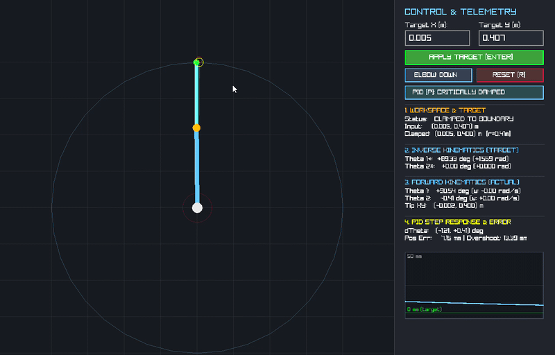

# Planar 2-DOF Robotic Arm: Inverse Kinematics & PID Control

A real-time **C++20** physics and control simulator for a 2-Degree-of-Freedom (2-DOF) planar manipulator. The project demonstrates analytical Inverse Kinematics (IK) with boundary singularity handling, decoupled joint-space PID controllers with switchable damping regimes, and an interactive laboratory telemetry inspector.



---

## Key Features

- **Analytical Inverse Kinematics (IK):** Real-time calculation of target joint angles ($\theta_1, \theta_2$) for any Cartesian target $(x, y)$, featuring annular workspace clamping ($\vert{}L_1 - L_2\vert{} \le r \le L_1 + L_2$), numerical singularity stabilization at full extension/retraction, and live **Elbow-Down / Elbow-Up** branch switching.
- **Joint-Space PID Control & Damping Regimes:** Independent discrete-time PID controllers with integral anti-windup driving each joint under simulated angular inertia and viscous damping. Includes a live toggle between **Critically Damped** (fast convergence without overshoot) and **Underdamped** presets to study transient overshoot and settling behavior.
- **Laboratory Control & Telemetry Inspector:**
  - **Dual Target Input:** Interactive left-click selection on the workspace grid or exact numeric coordinate entry (`Target X [m]`, `Target Y [m]`) with `ENTER` confirmation.
  - **Real-Time Step Response Oscilloscope:** Rolling 3-second plot of Cartesian tracking error (`mm`) with auto-scaling Y-axis and automatic peak overshoot detection.
  - **Live Diagnostics:** Real-time readout of workspace reachability status, target vs. actual joint angles, angular velocities ($\omega_1, \omega_2$), and Forward Kinematics (FK) end-effector coordinates alongside a fading trajectory trail and target ghost overlay.
- **Modern C++20 & Eigen3:** Clean separation of header-only kinematics and control math from the 60 FPS `Raylib` visualization layer, built cross-platform with `CMake`.

---

## Mathematical Model

### Forward Kinematics (FK)
Given link lengths $L_1, L_2$ and joint angles $\theta_1, \theta_2$:

$$x = L_1 \cos(\theta_1) + L_2 \cos(\theta_1 + \theta_2)$$

$$y = L_1 \sin(\theta_1) + L_2 \sin(\theta_1 + \theta_2)$$

### Inverse Kinematics (Elbow-Down / Elbow-Up)
For a target position $(x, y)$ clamped to the reachable annulus $\vert{}L_1 - L_2\vert{} \le r \le L_1 + L_2$:

$$\cos(\theta_2) = \frac{x^2 + y^2 - L_1^2 - L_2^2}{2 L_1 L_2}$$

$$\theta_2 = \text{atan2}\left(\pm\sqrt{1 - \cos^2(\theta_2)}, \, \cos(\theta_2)\right)$$

$$\theta_1 = \text{atan2}(y, x) - \text{atan2}\left(L_2 \sin(\theta_2), \, L_1 + L_2 \cos(\theta_2)\right)$$

### Decoupled Joint PID Control
Each joint tracks its target angle $\theta_i^*$ using discrete-time PID control with anti-windup clamping:

$$u_i(t) = K_p e_i(t) + K_i \int_0^t e_i(\tau)\,d\tau + K_d \frac{de_i(t)}{dt}, \quad e_i(t) = \theta_i^* - \theta_i(t)$$

---

## Controls & Shortcuts

| Input / Control | Action |
| :--- | :--- |
| **Left Mouse Click (Canvas)** | Set target coordinates $(x, y)$ interactively |
| **`Target X / Y` + `ENTER`** | Command exact Cartesian coordinates in meters |
| **`SPACE`** / `ELBOW` button | Toggle **Elbow-Down** / **Elbow-Up** IK configuration |
| **`P`** / `PID` button | Switch between **Critically Damped** and **Underdamped** PID presets |
| **`R`** / `RESET` button | Reset joint states, PID integrals, error history, and trajectory trail |

---

## Project Structure

```text
planar-arm-ik-pid/
├── assets/
│   └── demo.gif                        # Simulation showcase recording
├── include/
│   ├── control/
│   │   └── PidController.hpp           # Discrete PID regulator with anti-windup
│   └── kinematics/
│       └── PlanarArmKinematics.hpp     # Analytical 2-DOF FK/IK & workspace clamping
├── src/
│   └── main.cpp                        # Simulation loop, physics integration & Raylib UI
├── CMakeLists.txt                      # CMake build configuration (Eigen3 + Raylib)
├── .gitignore
└── README.md
```

---

## Build & Run

### Prerequisites
- C++20 compatible compiler (`GCC 11+`, `Clang 14+`, or `MSVC`)
- `CMake 3.16+` (automatically fetches `Eigen3` and `Raylib` archive packages via `FetchContent`)

### Compilation (Windows / MinGW)
```bash
cmake -B build -G "MinGW Makefiles"
cmake --build build --config Release
./build/arm_sim.exe
```

### Compilation (Linux / macOS)
```bash
cmake -B build
cmake --build build --config Release
./build/arm_sim
```